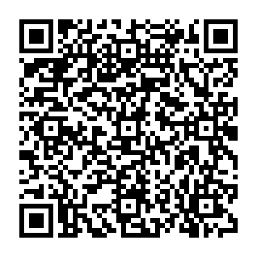

# Барометр для Amazfit Balance

Мини-приложение для Amazfit Balance первого поколения с Zepp OS 3.0 или новее. Оно показывает фактическое атмосферное давление с барометра часов. По умолчанию используется тёмная тема и мм рт. ст. Начальный язык берётся из настроек часов, для остальных языков используется английский.

В меню **Настройки** можно выбрать язык, единицы, светлую или тёмную тему и цвет показаний. Два индикатора изменения давления выключены по умолчанию. Чтобы добавить их, откройте **Тренд 1** или **Тренд 2** и нажмите **Выкл.**. Начальные периоды — 1 и 3 часа. У каждого индикатора отдельно выбираются период от 15 минут до 24 часов и формат **Стрелка** (↑ 3, ↓ 2, → 0) или **Знак** (+3, −2, 0).

### История замеров

Сбор истории начинается при включении первого тренда. Приложение регистрирует фоновый замер примерно каждые пять минут и сохраняет показания на часах. Zepp OS ограничивает запись в фоне, пока экран включён. Когда приложение открыто, оно тоже сохраняет измерения. Если в нужный момент показания ещё нет или в истории есть большой пробел, в карточке выводится **Сбор данных**. Если замеры чуть разошлись по времени с выбранным периодом, приложение оценивает начальное давление по двум соседним точкам либо использует недавнее показание перед началом периода.

Разница рассчитывается как текущее давление минус давление в начале периода. В 15:00 при 743 мм рт. ст., 745 в 14:00 и 740 в 12:00 изменение за час равно −2, за три часа — +3. Подъём или спуск тоже меняет давление на датчике.

### Установка через Zepp

1. Подключите Amazfit Balance к приложению Zepp на телефоне.
2. Включите режим разработчика. В Zepp откройте **Профиль → Настройки → О приложении** и семь раз нажмите на логотип Zepp.
3. Откройте **Профиль → Amazfit Balance → Режим разработчика → Сканировать**. Отсканируйте код с другого экрана.



- [Скачать .zpk для режима разработчика](https://raw.githubusercontent.com/tilipatov/amazfit-balance-barometer/main/downloads/v1.0.0/balance-barometer-1.0.0.zpk)
- [Скачать пакет сборки .zab](downloads/v1.0.0/balance-barometer-1.0.0.zab)

QR-код указывает на пакет предварительного просмотра. В метаданных пакета указан срок действия до 21.11.2026 в 03:39 UTC. Если Zepp отклоняет пакет или срок истёк, создайте свежий QR-код из исходников.

### Сборка и новый QR-код

Скачайте исходники репозитория и откройте папку проекта в терминале. Понадобятся Node.js 20, npm и аккаунт разработчика Zepp.

```sh
npm install
npx zeus login
npm run preview
```

Выберите **Amazfit Balance** и отсканируйте новый QR-код в режиме разработчика Zepp. Команда `npm run build` создаёт пакет `.zab` в папке `dist/`.

[Инструкция Zepp по установке на часы](https://docs.zepp.com/docs/guides/quick-start/preview/) · [Режим разработчика Zepp](https://docs.zepp.com/docs/guides/tools/zepp-app/)
