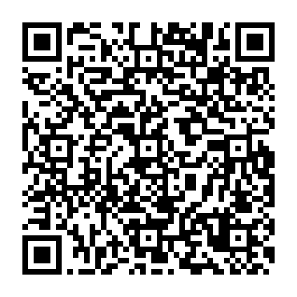
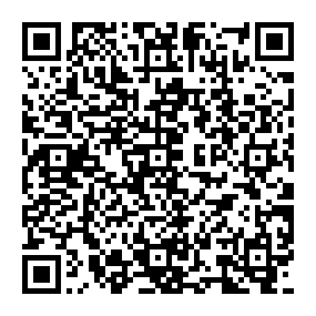
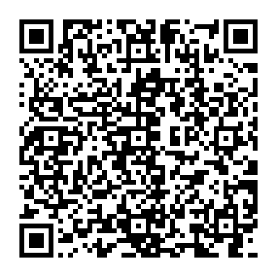

# Барометр для Amazfit Balance

Мини-приложение для Amazfit Balance первого поколения с Zepp OS 3.0 или новее. Оно показывает фактическое атмосферное давление с барометра часов. По умолчанию используется тёмная тема и мм рт. ст. Начальный язык берётся из настроек часов, для остальных языков используется английский.

Нажмите шестерёнку внизу экрана, чтобы открыть настройки. В разделе **Оформление** можно выбрать тему и цвет показаний. Переключатель **Десятые доли** задаёт формат текущего давления для любой единицы. При включении показывается одна цифра после точки, при выключении давление округляется до целого.

Два индикатора изменения давления выключены по умолчанию. Чтобы добавить их, откройте **Тренд 1** или **Тренд 2** и нажмите **Выкл.**. Начальные периоды — 1 и 3 часа. У каждого индикатора отдельно выбираются период от 15 минут до 24 часов и формат **Стрелка** (↑ 3, ↓ 2, → 0) или **Знак** (+3, −2, 0).

Чтобы открыть график сохранённых замеров, смахните вверх на экране давления. Смахните вниз, чтобы вернуться. В **Настройки → График** доступны периоды 3, 6, 12 и 24 часа и отдельный цвет линии. Линия строится по точному времени замеров и прерывается, если между ними больше 13 минут. Три метки шкалы времени приходятся на десятиминутные отметки, а ниже указано текущее время.

[История изменений](CHANGELOG.md) · [Стабильная версия 1.1.4](https://github.com/tilipatov/amazfit-balance-barometer/releases/tag/v1.1.4)

### История замеров

Когда приложение открыто, оно сохраняет измерения для графика и трендов. Если включён хотя бы один тренд, системный таймер также запускает разовый фоновый замер каждые десять минут. Zepp OS ограничивает запись в фоне, пока экран включён. Если оба тренда выключены, таймер останавливается.

Пункт **Настройки → Журнал замеров** показывает сохранённую историю по четыре записи на страницу. Видны полная дата, время, давление и источник. Над списком указано время последнего успешного фонового замера.

При первом запуске значение появится после накопления истории за выбранный период. Для быстрой проверки выберите **15 мин**. Пока нужного показания нет, в карточке выводится **Сбор данных**. Приложение оценивает начальное давление по двум соседним точкам либо берёт ближайший замер в пределах пяти минут. История измерений штатного барометра через API Zepp OS недоступна.

Разница рассчитывается как текущее давление минус давление в начале периода. В 15:00 при 743 мм рт. ст., 745 в 14:00 и 740 в 12:00 изменение за час равно −2, за три часа — +3. Подъём или спуск тоже меняет давление на датчике.

### Установка через Zepp

1. Подключите Amazfit Balance к приложению Zepp на телефоне.
2. Включите режим разработчика. В Zepp откройте **Профиль → Настройки → О приложении** и семь раз нажмите на логотип Zepp.
3. Откройте **Профиль → Amazfit Balance → Режим разработчика → Сканировать**. Отсканируйте код с другого экрана.



- [Скачать .zpk для режима разработчика](https://raw.githubusercontent.com/tilipatov/amazfit-balance-barometer/v1.1.4/downloads/v1.1.4/balance-barometer-1.1.4.zpk)
- [Скачать пакет сборки .zab](downloads/v1.1.4/balance-barometer-1.1.4.zab)

QR-код указывает на пакет предварительного просмотра. В метаданных пакета указан срок действия до 22.11.2026 в 08:15 UTC. Если срок истёк, создайте свежий QR-код из исходников по инструкции ниже. QR-код в разделе «О программе» открывает канал разработчика в Telegram. [Канал @bytenenras](https://t.me/bytenenras)

### Сборка и новый QR-код

Скачайте исходники репозитория и откройте папку проекта в терминале. Понадобятся Node.js 20, npm и аккаунт разработчика Zepp.

```sh
npm install
npx zeus login
npm run preview
```

Выберите **Amazfit Balance** и отсканируйте новый QR-код в режиме разработчика Zepp. Команда `npm run build` создаёт пакет `.zab` в папке `dist/`.

[Инструкция Zepp по установке на часы](https://docs.zepp.com/docs/guides/quick-start/preview/) · [Режим разработчика Zepp](https://docs.zepp.com/docs/guides/tools/zepp-app/)

### Диагностика в 1.1.5 Beta 1

Тестовую сборку можно установить через режим разработчика Zepp. Отсканируйте код с другого экрана. Пакет предварительного просмотра действует до 22.11.2026 в 10:11 UTC.



[Предварительный релиз](https://github.com/tilipatov/amazfit-balance-barometer/releases/tag/v1.1.5-beta.1) · [Пакет .zpk](https://raw.githubusercontent.com/tilipatov/amazfit-balance-barometer/v1.1.5-beta.1/downloads/v1.1.5-beta.1/balance-barometer-1.1.5-beta.1.zpk) · [Сборка .zab](downloads/v1.1.5-beta.1/balance-barometer-1.1.5-beta.1.zab)

Это тестовая сборка для проверки пропусков замеров. Оставьте хотя бы один тренд включённым. Когда заметите разрыв, откройте график на часах: приложение запишет состояние файла и число загруженных замеров. Затем в часах откройте **Настройки → Диагностика → Передать журнал в Zepp**. Держите Zepp открытым на телефоне до подтверждения передачи.

В Zepp откройте настройки мини-приложения **Барометр**. На странице диагностики видно время последней передачи и события за последние сутки. Переданная копия хранится в Zepp, её можно просмотреть без подключения к часам. Если часть журнала на часах не прочиталась, это будет указано отдельно.

Для параллельного сбора отладочных сообщений используйте фильтр `BarometerDiag` во вкладке **Device App** режима разработчика Zepp. Запустите сбор до теста. Метка `background start` выводится при входе в задачу, до чтения датчика и файлов. Если её нет, сначала убедитесь, что отладчик получал сообщения фоновой задачи на этих часах.

### Проверка 1.1.5 Beta 2

Тестовую сборку можно установить через режим разработчика Zepp. Отсканируйте код с другого экрана. Пакет предварительного просмотра действует до 22.11.2026 в 11:55 UTC.



[Предварительный релиз](https://github.com/tilipatov/amazfit-balance-barometer/releases/tag/v1.1.5-beta.2) · [Пакет .zpk](https://raw.githubusercontent.com/tilipatov/amazfit-balance-barometer/v1.1.5-beta.2/downloads/v1.1.5-beta.2/balance-barometer-1.1.5-beta.2.zpk) · [Сборка .zab](downloads/v1.1.5-beta.2/balance-barometer-1.1.5-beta.2.zab)

Установите Beta 2 поверх прежней версии. При доступе к старой истории барометр восстанавливает целые замеры из повреждённого файла и сохраняет оригинал. Новые данные пишутся в одну из двух чередующихся копий. Если запись не подтвердилась, приложение может прочитать предыдущую целую копию.

Оставьте один тренд включённым. В **Настройки → Диагностика → Интервал замеров** выберите **5 мин** и оставьте часы на 30–45 минут с закрытым барометром. Откройте график и передайте журнал в Zepp. Убедитесь, что новые замеры добавились к уже сохранённым. Затем верните **10 мин** и повторите проверку после нескольких часов. На телефоне отображаются результат чтения, состояние копий, число восстановленных записей и выбранный интервал.
